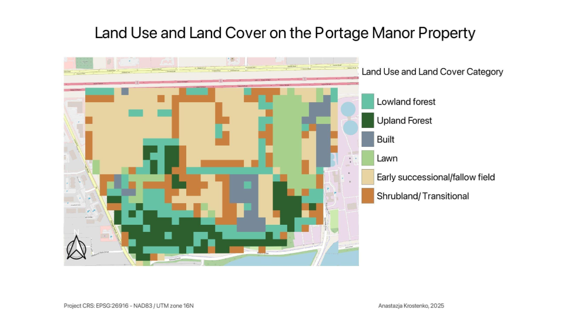
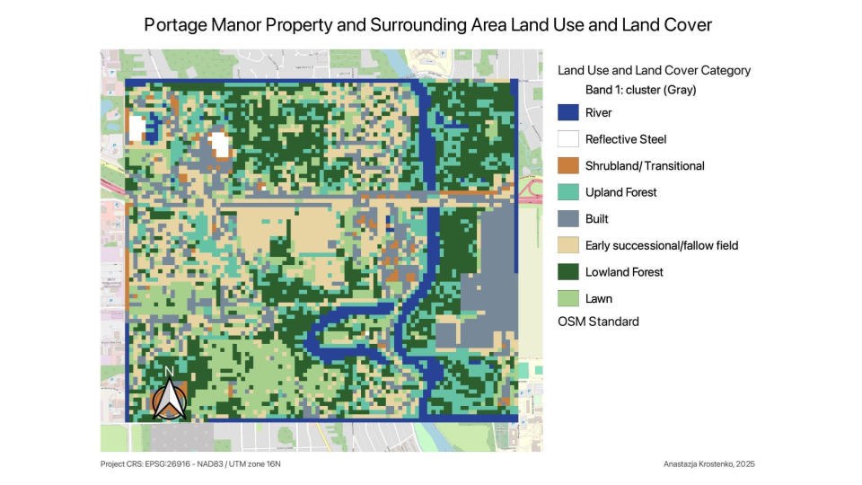

# LULC Classification: Portage Manor (South Bend, IN)

## Project Context
Following the 2023 closure of the county-owned Portage Manor facility in South Bend, Indiana, local policymakers evaluated competing proposals to either sell the 120-acre parcel for commercial/residential development or preserve it as public green space. Developed as an Earth Systems Senior Capstone at Stanford University, this project prepares classified land use/land cover maps which can serve as the precursor to quantify the parcel's natural capital value.

## Tools & Workflow
* **Google Earth Engine (JavaScript):**
  * **Imagery:** Built a median composite of Sentinel-2 surface reflectance imagery (`COPERNICUS/S2_SR`, April 2024 – July 2025), keeping scenes under 5% cloudy-pixel coverage and masking pixels with a cloud probability (`MSK_CLDPRB`) of 10% or more.
  * **Classification:** Ran unsupervised Weka K-means clustering on five Sentinel-2 bands (Blue `B2`, Green `B3`, Red `B4`, NIR `B8`, SWIR `B11`), sampling 3,000 pixels at 30 m. `01_portage_manor_lulc.js` uses `k=6` for the property itself; `02_portage_manor_expanded_lulc.js` uses `k=8` for a larger rectangle around it to capture the adjacent St. Joseph River and high-albedo industrial roofs. NDVI, NDWI and NDBI are calculated in the scripts but were not used in the final clustering.
  * **Labeling:** Assigned a land-cover class to each cluster by visually comparing it with the true-color satellite image. No formal accuracy assessment was done.
  * **Export:** Exported the classified rasters at 30 m in NAD83 / UTM zone 16N (`EPSG:26916`).
* **QGIS:** Produced the final maps over an OpenStreetMap basemap.

## Key Findings

* **Property (6 classes):** the northern and central parts of the parcel are mostly early successional/fallow field mixed with shrubland/transitional cover. Upland and lowland forest are concentrated along the southern edge near the St. Joseph River, a strip of lawn runs along the east side, and built cover corresponds to the former facility buildings.

* **Surrounding area (8 classes):** the two extra clusters separate the St. Joseph River and highly reflective steel roofs. The property's fallow field and forest stand out against a surrounding mix of built land, lawn and scattered forest, with a large built block to the east.
